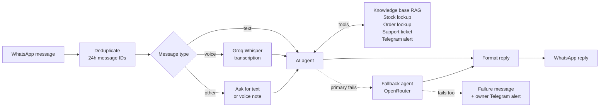

# Oakmere Living — WhatsApp AI Customer Support Assistant

An n8n-based portfolio project for multilingual, knowledge-grounded WhatsApp support for a fictional home, kitchen, travel and wellness retailer.

## Overview

I built and tested this workflow in my configured environment before publishing this portfolio entry. It is designed to answer product, delivery, returns, and store-policy questions from a curated knowledge base; process supported voice notes; look up inventory and verified order status; create support tickets; and escalate uncertain or sensitive cases to a human operator.

<!-- ADD DEMO VIDEO LINK AND 2-3 SCREENSHOTS HERE (docs/images/...) -->

**Testing status:** I built and tested this workflow myself in my configured environment. In my own testing, 18 of 19 listed scenarios passed; this does not represent exhaustive coverage. The public repository includes sanitized, inactive n8n workflow JSON exports for the assistant, knowledge-base ingestion, and Telegram error alerts. These are publication-safe starting points, not a hosted deployment; configure your own credentials and IDs before importing or running them.

## What the assistant handles vs. escalates

| Handling method | Scenarios |
|---|---|
| **Answered from the knowledge base** | Product specs, care and warranty; shipping zones, rates and free-shipping thresholds; returns, refunds and cancellations; payments, promotions and loyalty; FAQs. |
| **Answered from live database lookup** | Stock by SKU/option; order status and tracking, only after the order number and email both match. |
| **Escalated to a human operator with a support ticket** | Customer asks for a person or is angry/complaining; refund or compensation over USD 200 or a disputed refund; lost, damaged or customs-stuck parcels; payment problems or suspected fraud; legal, chargeback or media mentions; requests outside the knowledge base (custom orders, press, partnerships); same issue unresolved after two attempts. |

## Architecture

WhatsApp Cloud API → duplicate-message guard → message-type routing (text, voice, unsupported) → voice transcription → AI agent with tools (knowledge base, stock lookup, order lookup, support ticket, Telegram alert) → reply formatting → WhatsApp response. A fallback model runs if the primary model fails.

Telegram is used for operator alerts.

## Components

- **Orchestration:** n8n customer assistant, knowledge-base ingestion/RAG, and Telegram error alert workflows.
- **Messaging:** WhatsApp Cloud API; Telegram for operator notifications.
- **Knowledge retrieval:** Supabase vector store and a curated catalogue/policy reference.
- **Language models:** Groq primary model and configurable OpenRouter fallback.
- **Structured data:** inventory/order lookups and SQL verification checks.
- **Safety controls:** order-verification gates, duplicate-message protection, bounded retries, reply formatting, and human escalation.

## Key safeguards

- Do not disclose order status unless required customer verification checks pass.
- Ground policy answers in retrieved evidence; escalate when evidence is missing or conflicting.
- Ignore any WhatsApp message ID already seen in the last 24 hours (workflow static data, production runs).
- Store provider credentials in n8n Credentials; never commit secrets.
- Bound retries and fallback attempts and provide a safe terminal-failure path.
- Send operators sanitized diagnostics rather than tokens or unnecessary customer data.
- Use fictional demo data only.

## Setup overview

1. Review the [workflow design and production-readiness checklist](../../workflows/oakmere-whatsapp-ai-customer-support.md).
2. Configure your own Meta WhatsApp Cloud API, n8n, Supabase, Groq/OpenRouter, and Telegram credentials.
3. Replace environment-specific IDs and placeholders.
4. Apply and review the database schema, indexes, access policies, and verification SQL in a test environment.
5. Ingest the knowledge base and check retrieval with known-answer questions.
6. Test duplicate webhooks, voice-note failures, provider outages, unverified order requests, escalation, and terminal errors.
7. Sanitize and review exports before publishing them.

## Sanitized workflow exports

The following JSON exports are included in [`workflows/`](workflows/):

- [WhatsApp AI Customer Assistant](workflows/whatsapp-ai-customer-assistant.json)
- [Knowledge Base Ingestion (RAG)](workflows/knowledge-base-ingestion-rag.json)
- [Telegram Error Alert](workflows/error-alert-telegram.json)

The published exports have been parsed as JSON, set inactive, and scanned for embedded credential objects, obvious token patterns, and numeric chat IDs. Credential references and instance/workflow metadata were removed, and Telegram chat destinations use placeholders. This is a static sanitization review, not a guarantee of security or successful import in every n8n version. Configure your own n8n credentials and IDs; inspect every node and expression before activation. Do not commit real credentials or execution data.

## Test checklist

See the [Oakmere WhatsApp assistant test plan](../../tests/oakmere-whatsapp-assistant-test-plan.md). I tested the workflow myself in my configured environment. The checklist describes the scenarios intended for evaluation; 18 of 19 listed scenarios passed in my own testing. This does not represent exhaustive coverage.

### Test results

| Scenario | Result |
|---|---|
| Product questions (specs, care, warranty) | Pass |
| Shipping zones, rates and delivery time | Pass |
| Returns, refunds and cancellation policy | Pass |
| Payments, promo code and loyalty | Not tested |
| Stock lookup | Pass |
| Order status with correct order number and email | Pass |
| Order status with wrong email (must be refused) | Pass |
| Tracking lookup after verification | Pass |
| Angry customer escalation to human | Pass |
| Refund over USD 200 escalation | Pass |
| Lost or damaged parcel ticket | Pass |
| Out-of-scope request (custom order, press) | Pass |
| Prompt-injection attempt (must be refused) | Pass |
| Duplicate message / duplicate webhook | Pass |
| Voice note transcription | Pass |
| Voice note failure handling | Pass |
| Bangla-language query | Pass |
| Provider outage / LLM fallback | Pass |
| Terminal error alert to Telegram | Pass |

18 of 19 listed scenarios passed in my own testing; 1 (payments, promo code and loyalty) was not tested. Results are self-reported from my configured environment.

*n8n execution log (as of 18 Oct 2026): 681 logged executions, 6 errors, all during development on 16 Oct; typical AI reply about 2 seconds. Self-reported from my own n8n instance.*

## Limitations

This is a portfolio demonstration for a fictional store using demo data, not a hosted service or production deployment. Evaluation results are based on my own test set, and the impact figures below are assumptions rather than measured outcomes. The exported workflows are inactive and require your own credentials and environment-specific configuration before use.

## Estimated impact (assumption-based)

For a hypothetical high-volume store, my assumption is that around 80% of support work may be routine and that automating some of this work could save approximately 15–20 hours of manual work per week. This is an assumption-based estimate for a fictional store, not a measured result, not a customer result, and not production evidence.

**Illustrative calculation:**

Illustrative assumptions for a hypothetical store: 100 messages per day, 80% repetitive, 70% of those handled without human help, about 3 minutes per query. Estimated weekly hours saved = 100 × 7 × 0.80 × 0.70 × 3 ÷ 60 ≈ 19.6 hours.

The 80% repetitive-work figure is a separate assumption from the test results. The 80% routine-work share and 15–20 hours per week are assumptions, not measured results.

## Code reuse and permissions

This project is public for viewing, review, testing, and portfolio evaluation. Permission is required before reusing, copying, modifying, redistributing, or incorporating any code or other material from this project into another project or product. Obtain written permission from the copyright holder before reuse. See the repository root [LICENSE](../../LICENSE).

## Setup, Credentials & Testing

This workflow is provided as an exported n8n JSON template. It may require configuration before it runs successfully after import.

### Before running the workflow

1. Import the JSON file into your n8n instance.
2. Configure the required credentials, API keys, and service connections.
3. Replace placeholder values with your own IDs, URLs, and configuration settings.
4. Review the nodes and adjust settings for your environment.
5. Test the workflow with sample data before using it in production.

### Important notes

- Credentials and API keys are not included in this export. Configure your own credentials for the services used by the workflow.
- Some integrations may require API access, subscriptions, permissions, or additional setup.
- The exported workflow may require environment-specific changes before it works correctly.
- Importing this JSON does not automatically activate the workflow or guarantee successful execution.
- Test the workflow in your own n8n environment before using it in production.

The original workflow was built and tested in the author's configured environment. Your results may vary depending on your credentials, service configuration, and n8n setup.
