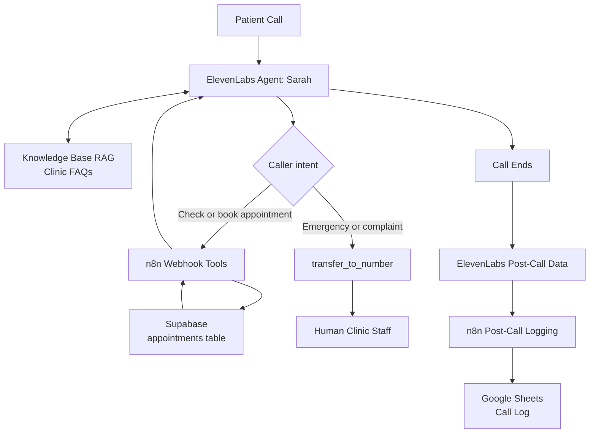

# Sarah — AI Voice Receptionist for Bright Smile Dental

An end-to-end conversational voice receptionist concept for a dental clinic. Sarah handles routine front-desk questions, checks appointment availability, books open slots, and escalates emergencies or complaints to human staff. n8n connects the voice agent to Supabase and records post-call outcomes in Google Sheets.

> **Project documentation and sanitized workflow exports.** The included n8n workflow exports are inactive templates. Configure credentials, webhook URLs, the Supabase table, Google Sheet, and ElevenLabs tools before running them. This repository does not contain live credentials or prove a production deployment.

## Tech stack

- **ElevenLabs Agents Platform (Conversational AI):** voice agent, knowledge-base RAG, tool calling, call transfer, moderation, and post-call analysis.
- **n8n:** webhook endpoints and workflow orchestration.
- **Supabase:** appointment slot storage and booking updates.
- **Google Sheets:** post-call activity log.

## Architecture



## 1. ElevenLabs agent configuration

### Agent identity and voice

| Setting | Configuration |
|---|---|
| Agent name | Sarah - Bright Smile Dental Receptionist |
| Voice | Lauren - Empathetic and Encouraging |
| First message | "Hi, this is Sarah from Bright Smile Dental. How can I help you today?" |

### System prompt

```text
You are Sarah, a friendly and professional receptionist for Bright Smile Dental clinic.

Your responsibilities:
1. Answer FAQ questions using the knowledge base (hours, services, pricing, location, insurance, cancellation policy).
2. Help callers book appointments — collect: name, phone number, preferred date, preferred time. When the caller tells you their name, always repeat it back to confirm spelling before proceeding. For example: "I heard your name as Deepu, is that correct?" If the caller corrects you, use the corrected spelling. Use check_availability tool to find open slots, then use book_appointment tool to confirm booking.
3. If the caller describes a dental emergency (severe pain, bleeding, swelling, injury) or files a complaint about service/billing, transfer the call to a human staff member using the transfer_to_number tool.
4. Do not provide medical advice or recommend medications under any circumstances — redirect to the dentist or transfer if it's an emergency.
5. Speak in a calm, natural, concise tone, like a real human receptionist. Avoid overly dramatic language.

Always be polite, clear, and efficient.
```

### Knowledge base (FAQ)

| Topic | Information |
|---|---|
| Clinic hours | Monday to Saturday, 9 AM to 7 PM; closed Sundays |
| Services | General checkups, teeth cleaning, cavity filling, root canal treatment, teeth whitening |
| Pricing | Checkup: 500 Taka; cleaning: 1,000 Taka; cavity filling: from 1,500 Taka; whitening: from 3,000 Taka |
| Insurance | Accepts most major providers |
| Location | House 12, Road 5, Dhanmondi, Dhaka |
| Cancellation policy | Cancel or reschedule 24 hours in advance |

### Agent tools

| Tool | Purpose | Integration |
|---|---|---|
| `check_availability` | Find unbooked appointment slots for a requested date | ElevenLabs webhook → n8n → Supabase |
| `book_appointment` | Mark a selected slot as booked and save patient details | ElevenLabs webhook → n8n → Supabase |
| `knowledge_base` | Retrieve clinic FAQ information | Built-in ElevenLabs RAG tool |
| `end_call` | End the conversation | ElevenLabs system tool |
| `transfer_to_number` | Escalate emergencies and complaints to clinic staff | ElevenLabs call transfer tool |

### Content guardrails

The agent's ElevenLabs built-in content moderation is configured as follows:

- **Execution mode:** Blocking
- **Action on violation:** Retry, with custom feedback sent to guide the agent's retry
- **Enabled:** Prevents discussion about medical or legal topics
- **Disabled:** Erotic or sexually explicit conversations; violence or physical harm content; abusive or threatening behavior; self-harm or suicidal content; vulgar or explicit language; political and religious discussions.

Only the medical/legal category is enabled for this receptionist configuration. The intent is to keep Sarah from answering medical questions and to redirect callers to a dentist or human staff member when appropriate. The other categories were left disabled because they were not considered relevant risks for this specific use case.

**Configuration note:** Validate the moderation behavior against the FAQ and emergency scenarios during testing. The enabled category may affect how dental-related questions are handled; do not assume every FAQ phrasing will pass moderation.

### Post-call analysis

- **Evaluation criterion:** whether an appointment was successfully booked, scored as binary success/fail.
- **Data collection fields:**
  - `caller_name`
  - `caller_phone`
  - `intent` — enum: `appointment_booking`, `faq_question`, `emergency`, `complaint`, `other`

## 2. Supabase database schema

### Table: `appointments`

| Column | Type | Description |
|---|---|---|
| `slot_date` | date | Appointment date |
| `slot_time` | time | Appointment time |
| `is_booked` | boolean | Whether the slot is already booked |
| `patient_name` | text | Patient name saved during booking |
| `patient_phone` | text | Patient phone number saved during booking |

### Booking logic

1. Appointment slots are pre-populated in `appointments` with `is_booked = false`.
2. The availability workflow filters rows where `is_booked = false` and `slot_date` matches the requested date.
3. The booking workflow matches a row by `slot_date + slot_time`, then sets `is_booked = true` and writes `patient_name` and `patient_phone`.

The workflow JSONs show the query and update operations. Add database-side constraints and concurrency protection before using this with real patient bookings.

## 3. n8n workflows

The three sanitized exports are in [`n8n-workflows/`](./n8n-workflows/).

### A. Check availability — `check-availability.json`

**Webhook path:** `POST /check-availability`

1. Receives the requested date in the webhook body.
2. Queries the Supabase `appointments` table for rows where `is_booked = false` and `slot_date` equals the requested date.
3. Returns the matching rows in an `available_slots` JSON array.

**Expected request field:** `body.date`  
**Response shape:** `{ "available_slots": [...] }`

### B. Book appointment — `book-appointment.json`

**Webhook path:** `POST /book-appointment`

1. Receives patient name, phone, date, and time.
2. Updates the Supabase row matching both `slot_date` and `slot_time`.
3. Sets `is_booked` to `true`, and stores `patient_name` and `patient_phone`.
4. Returns a JSON booking status and confirmation message.

**Expected request fields:** `body.name`, `body.phone`, `body.date`, `body.time`  
**Response shape:** `{ "status": "booked", "message": "..." }`

**Important implementation note:** The supplied export returns a booked response after the update node, but it does not explicitly verify that exactly one previously-open row was updated. Add availability re-checking, an atomic conditional update, and an explicit failure response for a missing/already-booked slot before relying on this workflow.

### C. Post-call logging — `post-call-logging.json`

**Webhook path:** `POST /post-call-log`

1. Receives ElevenLabs post-call data.
2. A Code node extracts `caller_name`, `caller_phone`, `intent`, `outcome`, `summary`, transcript data, conversation ID, and an ISO timestamp.
3. The Google Sheets node appends a row containing caller name, phone, intent, outcome, conversation ID, timestamp, and summary.
4. The workflow responds with `{ "status": "logged" }`.

The supplied Code node also creates a serialized `transcript` field, but the Google Sheets column mapping marks the Transcript column as removed, so the transcript is not appended by this export.

### Import and configuration

1. Import each JSON file into n8n.
2. Add your own Supabase and Google Sheets credentials; the exports contain placeholders/redacted credential references.
3. Configure the Google Sheet document and column headers to match the workflow mapping.
4. Copy the n8n production webhook URLs into the corresponding ElevenLabs tool definitions.
5. Configure the ElevenLabs post-call webhook to call the logging endpoint.
6. Test each workflow with sample data before enabling it. The committed exports currently have `active: false`.

## 4. How a call flows

Example: **Example Caller** wants to book a general checkup.

1. Example Caller phones Bright Smile Dental and hears Sarah's configured greeting.
2. The caller asks to book a checkup. Sarah collects their name and phone number, then repeats the name to confirm its spelling.
3. Sarah asks for the preferred date and time.
4. Sarah calls `check_availability`. The n8n webhook queries Supabase and returns the open slots for that date.
5. Sarah offers the available times. The caller chooses one.
6. Sarah calls `book_appointment` with the confirmed patient details and selected slot. n8n updates the matching Supabase row.
7. Sarah communicates the workflow's booking confirmation to the caller and ends the call.
8. ElevenLabs sends post-call data to the n8n logging webhook. The Code node formats the call details and Google Sheets appends the log row.

If the caller instead reports severe pain, bleeding, swelling, an injury, or a service/billing complaint, Sarah uses `transfer_to_number` to hand the call to human clinic staff rather than attempting to resolve it herself.

## 5. Future improvements

- Make booking atomic: only update a slot if it is still unbooked, and return a clear conflict response if another caller books it first.
- Validate and normalize phone numbers, dates, and times at the webhook boundary.
- Add required-field checks and structured error responses to both appointment endpoints.
- Add Supabase constraints and indexes for reliable slot lookup and prevention of duplicate bookings.
- Add authentication or signed requests for incoming webhooks, plus rate limiting and request validation.
- Review moderation settings with a test matrix covering routine FAQs, dental terminology, medical-advice requests, emergencies, and complaints.
- Add retry handling and failure alerts for post-call logging; avoid acknowledging a log as successful until the append operation has succeeded.
- Decide whether transcripts should be retained. If enabled, apply access controls, retention limits, and appropriate patient privacy safeguards.
- Expand call evaluation beyond booking success to include correct escalation, data capture accuracy, and caller experience.
- Add automated tests for available, unavailable, already-booked, malformed, and concurrent booking requests.

---

*Bright Smile Dental and the patient scenario are used as the project example. Do not use real patient data in demos or test logs.*
